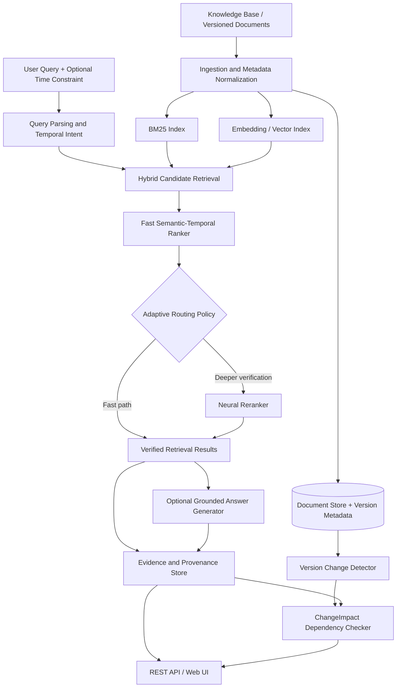

# TemporalProof

**Adaptive Temporal Retrieval for Evolving Knowledge Bases**

> A research-oriented, version-aware retrieval system designed to find evidence that is both semantically relevant and temporally appropriate, while adapting its retrieval and reranking effort to the query.

**Project status:** M0–M3 and M4 routing/blending/native TimelyRAG code evaluated locally; no established adaptive advantage, final test remains unevaluated.
**Academic context:** Undergraduate thesis / applied machine-learning research.  
**Primary focus:** Adaptive semantic–temporal information retrieval.  
**Secondary product feature:** ChangeImpact, a conservative evidence-dependency notification mechanism.  
**Target hardware:** One NVIDIA RTX 5060 Ti (16 GB VRAM) and a local development machine.

> [!IMPORTANT]
> This README specifies what we intend to build, how we will evaluate it, and what we will consider a successful research result. No benchmark scores, performance improvements, model quality claims, or production-readiness guarantees are asserted before the corresponding experiments have been completed.

### Available now: retrieval baselines and M4 experiments

The repository includes a typed Company Policies loader, metadata-only audit CLI,
frozen grouped split, CPU BM25 evaluation and tested retrieval metrics. On 100 fixed
validation queries over 30,000 passages, BM25 measured nDCG@10 **0.175959** and Recall@10
**0.230000**. These are local development-subset scores; final test and official
whole-benchmark results have not been measured. M2 adds pinned GPU multilingual E5,
FAISS cosine search, hybrid RRF and an insertion-time heuristic on the same validation IDs.
Hybrid measured nDCG@10 **0.207685**; the paired interval versus BM25 includes zero.
Dense alone and the added insertion heuristic did not improve mean quality over their
respective reference methods. M3 adds frozen-pool fixed MiniLM reranking and GPU profiling;
nDCG@10 falls to **0.109982**, adding **149.703 ms** mean rerank time. This model is not
adopted as the deep path. The Korean BGE follow-up reaches **0.163721**, adding
**1,148.100 ms** mean rerank time; it also falls below hybrid. See the
[M3 report](docs/m3_reranker_report.md) and
[Korean follow-up](docs/m3_korean_reranker_report.md) for regressions, profiling and the
train-only feasibility pilot. M4 now saves pre-deep features and train-only gain/cost
labels: on 100 training queries, hybrid nDCG@10 is **0.181688**, always-deep **0.158216**
and a fixed disagreement rule **0.187237**, routing 64% of queries at high modeled cost.
That pilot is an in-sample diagnostic; see the [M4 pilot report](docs/m4_train_pilot_report.md).
The next 500-query experiment fits a logistic router using 5 grouped folds: primary OOF
nDCG@10 **0.198929** versus hybrid **0.197016**, with **49/500** deep calls. Its interval
includes zero; a matched simple agreement control scores **0.204155**. A learned advantage
is not established. See the [grouped-router report](docs/m4_router_groupcv_report.md).
The frozen train500 model was then evaluated on all **495 development validation** queries:
nDCG@10 **0.190746**, below hybrid **0.198972** and matched agreement **0.198817**,
with 49 deep calls. Its paired group interval against hybrid is wholly negative;
matched-control intervals include zero. See the [validation report](docs/m4_router_validation_report.md).
No validation refit/threshold tuning; test remains unevaluated. Hybrid stays the reference.
A CPU-only conservative rank blend then selected deep weight **0.20** using train groups.
Grouped OOF reaches **0.196354** versus hybrid **0.197016**; frozen validation blend
**0.196351** versus hybrid **0.198972**. Reusing old 49-query logistic routes with the
blend reaches **0.199371**, but its paired interval against hybrid includes zero;
this is a secondary transfer diagnostic, not a newly trained router. Candidate coverage
and incomplete-judgment limitations are audited in the [M4.2 report](docs/m4_rankblend_report.md).
No new GPU inference or final test. Hybrid remains the reference.
The native automatic-alpha code from TimelyRAG is now checked on the same validation495:
BM25 **0.154621 → 0.146812**, CUDA E5 **0.141065 → 0.131546**, hybrid
**0.198335 → 0.173203** nDCG@10. Two GPU runs reproduce scores/ranks/alpha; all1,485
automatic top10s match the original function. The native tie policy and reference-prefix
metrics are kept explicit. This is matched local code reproduction with E5 transfers,
not reproduction of published whole-benchmark/BGE-M3 numbers. See the
[M4.3 reference report](docs/m4_timelyrag_reference_report.md). Final test remains closed.
API, product UI and final test remain planned.
See the [M2 report](docs/m2_retrieval_report.md) for all results and regressions.
See the [M1 report](docs/m1_bm25_report.md), [data card](docs/dataset_card.md),
[benchmark protocol](docs/benchmark_protocol.md) and [current status](docs/agent/CURRENT_STATUS.md).

From the repository root, with `uv` installed:

```bash
uv sync --frozen --group dev
uv run --frozen temporalproof-audit --download
uv run --frozen temporalproof-audit
uv run --frozen temporalproof-prepare-split
OMP_NUM_THREADS=1 MKL_NUM_THREADS=1 OPENBLAS_NUM_THREADS=1 \
  uv run --frozen temporalproof-bm25 --output artifacts/bm25/my_validation100_run
uv run --frozen pytest -q
uv run --frozen ruff check .
uv run --frozen ruff format --check .
```

`--download` explicitly fetches the pinned 5.8 MB benchmark archive and verifies its
checksum. Subsequent audits and normal tests require no dataset/model network access.
Raw data and generated reports are gitignored. Dataset redistribution terms remain
unresolved; no downloaded examples are included in the test fixture.
Choose a new BM25 output directory for each run. The committed split contains IDs only;
full rankings, qrels, timings and inspected failure text stay in ignored local artifacts.

### Local experiment tracking

Optional MLflow 3.18.0 tracking is implemented with local SQLite and artifact storage:

```bash
uv sync --frozen --extra tracking --group dev
uv run --frozen --extra tracking temporalproof-mlflow server
```

Open <http://127.0.0.1:5000>. Add `--mlflow` to `temporalproof-bm25` to log completed
results; use `uv run --frozen --extra tracking` for tracking-enabled commands. Logging
also works with the UI stopped. M1's original result has been imported with its original
provenance and a historical-import tag. See [local tracking instructions](docs/mlflow.md)
for artifacts, idempotent imports, restarting and optional-dependency behavior.

### GPU dense/hybrid comparison

```bash
uv sync --frozen --extra tracking --extra dense --group dev
uv run --frozen --extra tracking --extra dense temporalproof-fetch-encoder --download
OMP_NUM_THREADS=1 MKL_NUM_THREADS=1 OPENBLAS_NUM_THREADS=1 \
  HF_HUB_OFFLINE=1 HF_HUB_DISABLE_TELEMETRY=1 HF_HUB_DISABLE_PROGRESS_BARS=1 \
  uv run --frozen --extra tracking --extra dense temporalproof-compare --mlflow \
  --output artifacts/m2/my_validation100_run
```

Initial CUDA dependencies and ~493 MB encoder assets require network access; fetch is
explicit and checks pinned hashes. Evaluation is offline and requires CUDA. Corpus
embeddings are cached with data/model/code/environment identity and checksum validation.
Normal unit tests run on CPU with tiny arrays/fake encoders and do not download models.
Include both extras when using tracking and dense tools in the same environment.

### Fixed GPU reranking

After the original verified M2 run is available locally:

```bash
uv run --frozen --extra tracking --extra dense temporalproof-fetch-reranker --download
OMP_NUM_THREADS=1 MKL_NUM_THREADS=1 OPENBLAS_NUM_THREADS=1 \
  HF_HUB_OFFLINE=1 HF_HUB_DISABLE_TELEMETRY=1 HF_HUB_DISABLE_PROGRESS_BARS=1 \
  uv run --frozen --extra tracking --extra dense temporalproof-rerank --mlflow \
  --output artifacts/m3/my_validation100_run
```

The fixed config pins the original M2 source manifest and candidates. For another M2
run/machine, use a separately named config/source after verifying pool parity; see the
[M3 reproduction instructions](docs/m3_reranker_report.md#reproduction-and-next-action).
The ~493 MB reranker download is explicit. Scores, frozen candidates and detailed profile
stay local; only aggregate evidence is committed. Reported latency is rerank-only.

To reproduce the separately pinned Korean follow-up, keep the same candidates and use:

```bash
uv run --frozen --extra tracking --extra dense temporalproof-fetch-reranker \
  --model-id dragonkue/bge-reranker-v2-m3-ko --download
OMP_NUM_THREADS=1 MKL_NUM_THREADS=1 OPENBLAS_NUM_THREADS=1 \
  HF_HUB_OFFLINE=1 HF_HUB_DISABLE_TELEMETRY=1 HF_HUB_DISABLE_PROGRESS_BARS=1 \
  uv run --frozen --extra tracking --extra dense temporalproof-rerank --mlflow \
  --config configs/experiments/m3_korean_company_policies.json \
  --output artifacts/m3/my_korean_validation100_run
```

This model requires ~2.29 GB of explicitly fetched assets. It is an experimental
alternative; the default MiniLM config and its original negative result are retained.

### Train-only M4 feasibility pilot

With the original local models/data already available:

```bash
OMP_NUM_THREADS=1 MKL_NUM_THREADS=1 OPENBLAS_NUM_THREADS=1 \
  HF_HUB_OFFLINE=1 HF_HUB_DISABLE_TELEMETRY=1 HF_HUB_DISABLE_PROGRESS_BARS=1 \
  uv run --frozen --extra tracking --extra dense temporalproof-pilot --mlflow \
  --output artifacts/m4/my_train100_pilot
```

The predeclared config selects 100 train queries, freezes features before deep inference
and builds separate train-only utility targets. Validation/test configs and outcome/ID
inference columns are rejected. Models run sequentially; policy stage-cost sums are
modeled estimates, not live pipeline p95. Repeat into a new directory for replay; see
[protocol, controls and results](docs/m4_train_pilot_report.md).

### First learned router: grouped OOF on train500

After the pinned 500-query collection described in the report is available locally:

```bash
uv sync --frozen --extra tracking --extra dense --extra routing --group dev
OMP_NUM_THREADS=1 MKL_NUM_THREADS=1 OPENBLAS_NUM_THREADS=1 \
  uv run --frozen --extra tracking --extra dense --extra routing temporalproof-router-cv \
  --pilot-run artifacts/m4/company_policies_train500_v1 --mlflow \
  --output artifacts/m4/my_router_groupcv
```

The `routing` extra pins sklearn 1.9.1. Imputation/scaling/model fitting stay within each
training fold; quotas are allocated inside each held-out fold without outcomes/costs.
Versioned JSON model states avoid pickle. A primary model fitted on all 500 selected
train rows is saved for future validation. The result is not a live routed latency or
final-test claim. [Protocol, replay, controls and source pins](docs/m4_router_groupcv_report.md).

---

## Table of Contents

1. [Project Overview](#1-project-overview)
2. [Motivation and Problem Statement](#2-motivation-and-problem-statement)
3. [Thesis Topic, Goal, and Objectives](#3-thesis-topic-goal-and-objectives)
4. [Scope and Non-Goals](#4-scope-and-non-goals)
5. [Research Questions and Hypotheses](#5-research-questions-and-hypotheses)
6. [Proposed Research Contribution](#6-proposed-research-contribution)
7. [System Architecture](#7-system-architecture)
8. [Core Retrieval Pipeline](#8-core-retrieval-pipeline)
9. [Adaptive Reranking: Learning and Inference](#9-adaptive-reranking-learning-and-inference)
10. [Temporal Data Model and Version Semantics](#10-temporal-data-model-and-version-semantics)
11. [ChangeImpact: Evidence Dependency Tracking](#11-changeimpact-evidence-dependency-tracking)
12. [Datasets and Benchmarks](#12-datasets-and-benchmarks)
13. [Data Preparation and Leakage Prevention](#13-data-preparation-and-leakage-prevention)
14. [Baseline Methods and Experiment Matrix](#14-baseline-methods-and-experiment-matrix)
15. [Evaluation Protocol and Metrics](#15-evaluation-protocol-and-metrics)
16. [Model and Hardware Strategy](#16-model-and-hardware-strategy)
17. [Technology Stack](#17-technology-stack)
18. [Repository Structure](#18-repository-structure)
19. [Service Features and API Design](#19-service-features-and-api-design)
20. [Testing Strategy](#20-testing-strategy)
21. [Load Testing and Observability](#21-load-testing-and-observability)
22. [Reproducibility and Experiment Tracking](#22-reproducibility-and-experiment-tracking)
23. [Development Roadmap](#23-development-roadmap)
24. [Definition of Done](#24-definition-of-done)
25. [Risks, Constraints, and Fallback Plans](#25-risks-constraints-and-fallback-plans)
26. [Security, Privacy, and Responsible Use](#26-security-privacy-and-responsible-use)
27. [Related Work and References](#27-related-work-and-references)
28. [Immediate Next Steps](#28-immediate-next-steps)

---

## 1. Project Overview

TemporalProof is a proposed **end-to-end research and software engineering project** addressing a fundamental weakness of conventional Retrieval-Augmented Generation (RAG): a retrieved document may be topically relevant while being **incorrect for the requested time period**.

Knowledge bases evolve. Policies are revised, product terms change, university regulations are amended, and historical information remains useful for retrospective questions. A conventional semantic retriever can confuse an earlier version with the current one because both versions discuss the same subject using nearly identical language.

TemporalProof aims to retrieve evidence that satisfies **both semantic relevance and temporal intent**. Instead of always applying an expensive neural reranker, it will investigate an **adaptive reranking policy** that allocates additional computation to queries where deeper verification is expected to provide meaningful value.

The deliverable is intended to include:

- A **reproducible ML research pipeline** with baselines, training, evaluation, and ablations.
- A **version-aware retrieval engine** supporting time-constrained queries.
- A **learned adaptive reranking component** with an explicit quality–latency objective.
- An optional **grounded answer-generation layer** with evidence citations.
- A working **REST API and web application** for uploading, searching, and comparing knowledge-base versions.
- **ChangeImpact**, a conservative mechanism that flags saved answers whose referenced source passages have changed.
- **Automated tests, load testing, monitoring, CI, containerized deployment, and documentation**.

### What this project is not

TemporalProof is **not** an attempt to train a large foundation model from scratch, create a universal autonomous legal reasoning system, or claim that a single heuristic solves temporal retrieval. It is a focused, experimentally testable retrieval-method project combined with a useful software product.

### Example use case

A company publishes three updates to a travel policy. A user asks:

> What reimbursement limit applied to domestic travel in April 2025, and how did it change by September 2026?

The system should identify the relevant time anchors, retrieve the appropriate policy versions, preserve distinctions between historical and current rules, and present evidence for both periods. If the sources are ambiguous or incomplete, it should say so rather than invent a definitive answer.

---

## 2. Motivation and Problem Statement

### 2.1. Why ordinary RAG is insufficient

Classical retrieval pipelines prioritize textual similarity and often ignore the relationship between the **query's temporal intent** and the **document's applicability period**. As a result:

1. An obsolete revision can outrank an applicable revision.
2. Partial amendments may leave several highly similar but semantically different passages in the corpus.
3. Cross-period comparison queries require evidence from **multiple** relevant periods rather than one latest document.
4. Some queries are easy, while others require expensive reasoning or cross-encoder verification.
5. Running the most expensive reranker on every request unnecessarily increases latency and computational cost.

### 2.2. Practical relevance

Target scenarios include:

- Enterprise knowledge management and internal policy search.
- University and institutional regulations.
- Terms-of-service and service-policy history.
- Documentation and changelog search.
- Internal assistants answering both current and historical questions.

The proposed system should be especially useful when documents are regularly updated and users need verifiable answers about **what was valid or known at a particular time**.

### 2.3. Research gap

Work such as **TimelyRAG** already demonstrates the value of temporal-aware ranking. Therefore, simply combining BM25 with a timestamp bonus is **not** a sufficient claim of novelty.

Our research question is narrower and more measurable: **Can an adaptive retrieval policy recognize when expensive semantic–temporal verification is worth its cost, and achieve a better quality–latency trade-off than fixed pipelines?**

Existing methods should be reproduced and treated as competitors, not misrepresented as newly invented capabilities.

---

## 3. Thesis Topic, Goal, and Objectives

### Proposed thesis title

**English:** *Development of an Adaptive Semantic–Temporal Information Retrieval Method for Evolving Knowledge Bases*

**Russian:** *Разработка метода адаптивного семантико-временного поиска в динамически обновляемых базах знаний*

### Research goal

Develop and evaluate an adaptive semantic–temporal retrieval method that accounts for temporal relevance and conditionally allocates reranking effort, then integrate it into a functioning, version-aware knowledge-base service.

### Thesis objectives

1. Review existing approaches to information retrieval, temporal relevance, learning-to-rank, adaptive inference, and version-aware RAG.
2. Inspect and prepare publicly available temporal retrieval benchmarks.
3. Reproduce semantic, lexical, and time-aware retrieval baselines.
4. Design features describing the query, initial ranking, temporal ambiguity, and expected benefit of deeper reranking.
5. Train and evaluate an adaptive routing or budget-allocation model using existing relevance judgments and measured inference costs.
6. Compare the proposed method against strong fixed and rule-based alternatives under matched conditions.
7. Build a version-aware knowledge-base service with source citations and an interactive interface.
8. Implement evidence-dependency tracking for previously generated answers (ChangeImpact).
9. Validate correctness, performance, reproducibility, and resource consumption.
10. Analyze limitations and document findings without overstating model capabilities.

---

## 4. Scope and Non-Goals

### In scope — minimum viable research system

- Text-centric knowledge bases with document IDs, version metadata, and available timestamps.
- Temporal queries involving an explicit date, time interval, or historical comparison.
- Deterministic lexical retrieval and neural semantic retrieval.
- Semantic–temporal reranking and an **adaptive decision policy**.
- Offline training/evaluation on published benchmark relevance labels.
- REST endpoints for document version ingestion, search, and feedback visualization.
- Persisted provenance links between generated answers and retrieved evidence.
- Meaningful automated and performance tests.

### In scope — optional enhancements

- Local answer generation with a compact BF16 LLM.
- A richer query planner for multi-period questions.
- Comparison of two document versions in the UI.
- Progressive or budgeted reranking of only selected candidates.
- A Rust-based high-performance retrieval gateway, if profiling justifies it.
- Additional domains or multilingual evaluation after the main experiments.

### Out of scope for the thesis core

- Guaranteed legal interpretation and automatic legal decision-making.
- Training a 7B+ model from scratch or making a large LLM the primary research contribution.
- OCR pipelines for complex scans, handwriting, or arbitrary visual documents.
- Automatically proving that every previously issued answer is factually obsolete.
- A large, manually annotated proprietary dataset.
- A fully distributed microservice platform or Kubernetes deployment without a concrete need.
- Claims about real business conversion, savings, or end-user outcomes without actual measurements.

---

## 5. Research Questions and Hypotheses

### RQ1 — Semantic versus temporal relevance

How much do explicit temporal signals improve retrieval over lexical-only and dense-only search on versioned document collections?

**H1:** A semantic–temporal ranking method will improve relevant-evidence retrieval on temporally ambiguous queries compared with semantic-only baselines, given a consistent evaluation protocol.

### RQ2 — Adaptive compute allocation

Can the system predict which queries benefit from expensive reranking using **only features available before the expensive reranker is run**?

**H2 (primary):** A learned routing policy can approach the quality of an always-on neural reranker while reducing average reranking cost and/or end-to-end latency, relative to fixed and rule-based policies under the same workload.

This is a hypothesis, not an expected result. The always-on method may remain superior, especially on difficult queries.

### RQ3 — Temporal ambiguity and error analysis

Which error types can be identified reliably: obsolete versions, ambiguous time anchors, incomplete cross-period evidence, or closely related amendments?

**H3:** Query-level temporal features and initial-ranking uncertainty may help separate easy and hard retrieval cases, but their predictive value must be established empirically.

### RQ4 — Practical operation

Can the pipeline run as an interactive local service with reproducible latency, resource, and correctness measurements on one 16 GB GPU?

**H4:** A compact retrieval stack with optional sequential neural inference can support a useful single-node demonstration without requiring quantized large-model training.

### Explicit success criteria

- Measurable performance on **held-out queries** and, if possible, a held-out domain.
- A meaningful quality–latency **Pareto comparison** rather than one cherry-picked score.
- Ablation evidence for which features or components matter.
- A functioning prototype with testable APIs and observable resource usage.
- Honest reporting if the adaptive policy fails to outperform simple baselines.

---

## 6. Proposed Research Contribution

The working name of the proposed method is **Adaptive Semantic–Temporal Reranking (ASTR)**. The name is provisional and does not imply established scientific novelty.

### 6.1. Core idea

A fast retrieval stage produces candidate documents and lightweight ranking signals. An adaptive controller evaluates the query and ranking context, then chooses among:

- **Fast path:** return the lightweight semantic–temporal ranking.
- **Verification path:** apply a more expensive cross-encoder or temporal verification model to a candidate subset.
- **Optional extended path:** expand temporal coverage or run additional retrieval for a cross-period question, subject to a budget.

The objective is to **maximize retrieval quality under a cost constraint**, not to add a second model without evidence that it helps.

### 6.2. Candidate routing signals

Potential features — all computed before expensive reranking — include:

- Number and type of time anchors in the query.
- Presence of comparison language ("before", "after", "changed", "as of").
- Query length and query embedding statistics.
- Agreement or disagreement between BM25 and dense rankings.
- Score margin between top candidates and score-distribution entropy.
- Number of distinct document versions among top-k results.
- Distance between candidate time metadata and requested time interval.
- Ratio of retrieved evidence that covers each requested period.
- Presence of missing or conflicting time metadata.

No feature may depend on the **actual result of the expensive reranker** at inference time; that would introduce hidden oracle leakage.

### 6.3. Candidate learning approaches

1. **Rule-based policy:** hand-designed uncertainty thresholds.
2. **CatBoost / LightGBM router:** predict expected gain or whether a reranker is worthwhile.
3. **Small MLP or logistic regression:** lightweight learned decision layer.
4. **Budget-aware policy:** optimize a simple utility such as quality gain minus latency penalty.

Start with the simplest methods. A neural router is not required unless it shows an actual benefit.

### 6.4. Research contribution versus product contribution

| Research | Product engineering |
|---|---|
| Adaptive query-level reranking policy | Versioned knowledge-base ingestion |
| Temporal and ranking uncertainty features | REST API and UI |
| Quality–latency experiments | Evidence citations and change history |
| Ablations and baseline comparison | ChangeImpact notifications |
| Generalization/error analysis | Docker, CI, tests, monitoring |

---

## 7. System Architecture

The proposed architecture intentionally separates **research components** from **application components**.



### Recommended deployment boundary

- **Python ML worker:** embeddings, trained rankers, router, optional generation.
- **Single API service:** Python/FastAPI first; Rust can become a separate gateway if justified.
- **PostgreSQL:** metadata, versions, saved questions/answers, provenance, change events.
- **Search indices:** BM25 and dense-vector index; choose local components for the MVP.
- **Web application:** search, evidence, historical comparisons, and change notifications.

A single-process or few-service design is preferred to premature microservice decomposition.

---

## 8. Core Retrieval Pipeline

### Stage A — Ingestion

1. Accept a text document or a supported PDF/DOCX extraction workflow (text extraction only in the MVP).
2. Compute stable source ID, version ID, content hash, ingestion timestamp, and optional validity metadata.
3. Split content into traceable passages without losing section headings or source offsets.
4. Generate embeddings and update lexical and vector indices.
5. Preserve previous versions rather than overwriting their content.

### Stage B — Query analysis

Determine whether a question asks about:

- **Current state** (as of a chosen reference date).
- **Historical state** (as of a past date).
- **A time interval** (evidence applicable during a range).
- **Cross-period comparison** (evidence from more than one interval).
- **No explicit time** (conservative default; expose which reference time was used).

Explicit timestamps should override inferred temporal intent. Ambiguous or missing time metadata should remain visible as uncertainty.

### Stage C — Candidate retrieval

Retrieve candidates through BM25 and a compact dense retriever. Combine candidates with reciprocal rank fusion (RRF) or a calibrated score merger, keeping source IDs and time metadata intact.

### Stage D — Fast semantic–temporal ranking

Combine lexical, semantic, and time-related features. Distinguish **publication time** from **effective time** where the data genuinely supports that distinction.

### Stage E — Adaptive verification

A lightweight controller decides whether the candidate list is sufficiently reliable or whether more expensive reranking is warranted.

### Stage F — Evidence delivery

Return:

- Ranked passages and source references.
- Available version and temporal metadata.
- Retrieval method/path selected by the controller.
- Confidence/uncertainty indicators only if appropriately calibrated.
- Optional answer generated strictly from selected evidence.

**Critical rule:** an evidence passage retrieved for the wrong date must not be presented as correct just because it is semantically similar.

---

## 9. Adaptive Reranking: Learning and Inference

### 9.1. Why this is the main ML task

The adaptive controller is where our project attempts to move beyond a standard fixed RAG pipeline. It must be learned, evaluated, and compared with strong alternatives on **existing labeled datasets**.

### 9.2. Training signal without new manual labels

For each training query:

1. Run the **fast pipeline** and store its ranked candidate list.
2. Run the **expensive reranker** using the same initial candidates.
3. Compute an official retrieval-quality metric for both ranked lists using **published gold relevance labels**.
4. Measure actual reranking cost on the target hardware.
5. Calculate an example utility signal, for example:

```text
quality_gain(q) = metric(deep_results(q)) - metric(fast_results(q))

utility(q) = quality_gain(q) - lambda * measured_extra_cost(q)

route_label(q) = 1 if utility(q) > 0 else 0
```

The cost term must use a declared unit (e.g., milliseconds or normalized GPU time); `lambda` is selected **on validation data**. We may instead train a regressor for expected gain and choose a threshold based on the latency budget.

**Important:** labels are derived from official gold relevance judgments. They are not newly hand-annotated examples, but we must still implement the data preparation pipeline and inspect noisy/censored signals.

### 9.3. Preventing router leakage

- Split by **query groups**, not individual query–document pairs.
- Prefer document-family/version-group separation where possible.
- Generate expensive-reranker outcomes for the **training split only** when fitting the router; use validation labels strictly for model selection.
- Never use test gold labels, test oracle gains, or future events as inference features.
- Consider out-of-fold predictions for training-time teacher signals if base models are trained on the same queries.
- Keep the set of candidate documents and retrieval budget consistent across comparable runs.
- Report the **oracle router** only as a diagnostic upper bound, never as a deployable algorithm.

### 9.4. Policy alternatives to compare

- **Always fast:** never run the expensive reranker.
- **Always deep:** always run it.
- **Random budget-matched:** route a random share of queries with the same average deep-call budget.
- **Simple temporal rule:** route queries with dates or historical comparison terms.
- **Score-margin / uncertainty rule:** rerank when initial rankings are ambiguous.
- **Learned adaptive router:** our candidate method.
- **Oracle upper bound:** retrospectively choose the better route, using gold labels; non-deployable.

### 9.5. Fairness of comparison

The deep model should be competitively tuned. If a trivial, poorly tuned reranker is used, proving that we skip it is not a meaningful result.

We will compare policies across **multiple operating points**, e.g., 0%, 25%, 50%, 75%, and 100% of queries entering the deep path, or across fixed measured latency budgets. At each point, report retrieval metrics, average/p95 latency, and GPU cost.

### 9.6. What happens if adaptation does not help?

That is a valid experimental outcome. The thesis can still deliver a version-aware retrieval system and a rigorous comparison. We will not hide cases where always-deep or a simple rule performs better; the research contribution will then be bounded by documented conditions and limitations.

---

## 10. Temporal Data Model and Version Semantics

The service should preserve several distinct concepts:

| Field | Meaning |
|---|---|
| `document_id` | Stable identifier of the logical document |
| `version_id` | Unique identifier of one revision |
| `source_uri` | Origin of the evidence |
| `published_at` | When the revision was published, if known |
| `ingested_at` | When the system received it |
| `valid_from` / `valid_until` | Period when content applies, if explicitly known or reliably derived |
| `section_path` | Traceable section/clause location |
| `content_hash` | Checksum for change detection |
| `supersedes` | Explicit version relationship, if known |

### Bitemporal semantics (optional advanced feature)

Two questions can differ:

- **What policy was effective on 2025-04-01?**
- **What policy did the organization know about on 2025-04-01?**

The first refers to *valid/effective time*. The second refers to *knowledge/transaction time*. A revision published later can sometimes affect an earlier valid period.

**However, published benchmarks do not necessarily label every field needed for full bitemporal reasoning.** We will not infer legal effect merely from document ingestion dates. Missing applicability metadata should be recorded as unknown.

### Version preservation

- Do not delete historical text after an update.
- Rebuild only affected index entries where possible.
- Make retrieval filtering explicit and inspectable.
- Resolve overlapping revisions conservatively.
- Clearly distinguish the **requested answer date** from the **current ingestion date**.

---

## 11. ChangeImpact: Evidence Dependency Tracking

**Status:** Secondary product feature, not the primary supervised-learning task.

### The problem

A user has already received an answer grounded in a particular policy passage. After that policy is updated, the original passage may have changed. The system should help determine which saved answers **need review**.

### Planned behavior

1. Record the relationship `answer -> cited_passages -> document_version`.
2. Detect newly ingested revisions and changed passages using checksums/text diffs.
3. Traverse affected provenance links.
4. Mark dependent answers as **`review_required`**, with a reference to the changed evidence.
5. Provide old/new passage comparison and optionally offer to rerun the retrieval pipeline.
6. Preserve historical answers that were explicitly asked **for a historical date**; a new revision does not automatically make them wrong.

### What ChangeImpact must NOT claim

A changed citation does **not** prove that the final answer is false. A cosmetic update may have no semantic impact; a semantic update may leave the answer unchanged. Accordingly, the MVP reports **possible impact and dependency** rather than verified factual invalidation.

No custom annotation dataset is required for the dependency flagging logic. We can test deterministic behavior with controlled fixtures and a small manually inspected **demo** without positioning that demo as a statistically valid ML benchmark.

### Stretch goal

If a public high-quality answer-invalidation benchmark becomes available later, evaluate a semantic impact classifier. This is **optional** and must not block the thesis.

---

## 12. Datasets and Benchmarks

### 12.1. Primary dataset: TimelyQABench (TimelyRAG)

**Official source:** https://github.com/kaist-dmlab/TimelyRAG  
**Paper:** https://aclanthology.org/2026.findings-emnlp.398/  
**Implementation/data:** The official repository contains benchmark files, dataset-loading code, and baseline retrieval code.

The repository currently describes **four domains**, each with **30,000 documents and 3,000 queries**:

| Domain | Documents | Queries | Intended role |
|---|---:|---:|---|
| Law | 30,000 | 3,000 | Domain transfer / optional evaluation |
| University | 30,000 | 3,000 | Domain transfer / optional evaluation |
| Company Policies | 30,000 | 3,000 | **Initial development domain** |
| Terms of Service | 30,000 | 3,000 | Hold-out or supplementary evaluation |
| **Total** | **120,000** | **12,000** | Full benchmark after feasibility check |

The published loader supports, among other fields, gold document IDs, `query_event_time`, `query_insert_time`, document `event_time`, and `doc_insert_time`. Actual schemas and missingness must be examined before relying on them.

**Why we will start here:** it closely matches evolving/overlapping documents, has existing gold relevance judgments, and comes with an official temporal-retrieval reference implementation.

**Important limitations:**

- The benchmark is designed to evaluate retrieval, **not** the semantic invalidation of previously generated answers.
- Document/query timestamps must not be silently equated with fully known validity intervals.
- The license and redistribution terms must be reviewed before publishing copies of the data, checkpoints, or derived corpora. The public repository does not by itself guarantee unrestricted redistribution.
- The exact language, document lengths, gold-label format, duplicates, and available official splits should be inspected locally before implementation decisions are finalized.

**First milestone:** Download and inspect the Company Policies domain, verify field coverage, and reproduce one reference ranking score using the official evaluation logic.

### 12.2. Secondary benchmark: TEMPO

**Official repository:** https://github.com/tempo-bench/Tempo  
**Dataset:** https://huggingface.co/datasets/tempo26/Tempo  
**Project page:** https://tempo-bench.github.io/  
**Paper:** https://aclanthology.org/2026.emnlp-main.291/

TEMPO provides:

- **1,730 complex temporal retrieval queries** across **13 domains**.
- **3,976 step-wise retrieval tasks**, with gold evidence documents for step-wise analysis.
- A large corpus (over **1.6 million** documents) across domains.
- Official retrieval evaluation code and published baselines.
- Additional temporal metrics, including **Temporal Coverage@k** and **Temporal Precision@k**.

**Our plan:** use selected domains or manageable corpus subsets for independent stress testing, then expand if hardware, disk, and time permit. A full multi-domain evaluation is a stretch goal, not a prerequisite to a valid thesis.

**Critical evaluation caveat:** Some of the official TEMPO temporal-metric code uses an **LLM judge** through external provider APIs. We will:

1. Report deterministic retrieval metrics against published gold document IDs as the primary reproducible results.
2. Clearly separate judge-based metrics from deterministic metrics.
3. Report model/provider/prompt and potential API costs if judge-based metrics are run.
4. Never compare an approximate local judge score directly with an official judge score as if both were identical protocols.

**Data-license caution:** The Hugging Face dataset card states `cc-by-4.0`, while its source-content description refers to Stack Exchange / CC-BY-SA material. We will examine source-level obligations before redistribution; the card alone is not sufficient to settle all downstream content rights.

### 12.3. Additional optional evaluation sources

- **BEIR** — https://github.com/beir-cellar/beir — general retrieval transfer tests (not a temporal benchmark).
- **BRIGHT** — https://brightbenchmark.github.io/ — reasoning-intensive retrieval (not a substitute for temporal labels).

These are optional robustness tests and should not displace the two primary datasets.

### 12.4. Dataset usage rules

- Use public benchmark labels for the main ML objective.
- Do **not** create a large manually labeled proprietary dataset as a critical dependency.
- Store raw data outside Git; use download scripts and file hashes.
- Keep a data card with provenance, dataset version, terms, splits, schema, and processing decisions.
- Treat domain transfer and temporal transfer as distinct evaluation questions.

---

## 13. Data Preparation and Leakage Prevention

### Data audit checklist

- [ ] Confirm download integrity and total records per domain.
- [ ] Inspect document/query language and encodings.
- [ ] Quantify missing or malformed temporal metadata.
- [ ] Inspect relevance-label schema and official evaluation behavior.
- [ ] Check duplicate and near-duplicate passages across versions.
- [ ] Identify document families and version chains where possible.
- [ ] Record text lengths and calculate embedding/index storage requirements.
- [ ] Read and document data usage and redistribution restrictions.

### Query-level split policy

A query–document dataset must not be randomly split at the pair level, because that would place different candidate pairs from the same query into both training and evaluation.

Prefer:

- Official benchmark split when supplied and justified.
- Otherwise a deterministic **query-grouped** train/validation/test split.
- Additional document-family or version-chain group separation if feasible.
- Optional held-out-domain generalization experiment.

If creating a new split, publish only **IDs / split manifests**, not copyrighted raw content.

### Temporal leakage

Evaluation must respect the question being asked. If a benchmark models what was known by a historical date, documents introduced after that knowledge cut-off must not be visible as evidence. Conversely, for retrospective questions about what was *valid* at an earlier time, later-published sources may sometimes be relevant; these cases must not be conflated.

Temporal rules are defined per experiment and documented explicitly. We will not invent ground-truth applicability periods absent from the source data.

### Hard-negative mining

Mine semantically similar but temporally inappropriate candidates from the **training corpus only**. Keep automatic negatives clearly separated from official gold labels and do not assume all unjudged documents are truly irrelevant.

### Evaluation integrity

- Freeze test queries before feature engineering and parameter search.
- Do not tune thresholds using test labels.
- Make corpus scope and candidate pools consistent among comparisons.
- Log evaluation scripts, metrics, random seeds, and commit IDs.
- Bootstrap confidence intervals over **queries**, not individual candidate rows.

---

## 14. Baseline Methods and Experiment Matrix

All baselines must use comparable corpora, candidate budgets, and the correct official relevance judgments.

| ID | Method | Primary purpose |
|---|---|---|
| B0 | BM25 | Lexical baseline |
| B1 | Dense retrieval (compact sentence embedding) | Semantic-only baseline |
| B2 | BM25 + dense hybrid / RRF | Strong low-cost baseline |
| B3 | Temporal filtering / temporal score heuristic | Simple time-aware baseline |
| B4 | Official TimelyRAG implementation | Published temporal baseline |
| B5 | Hybrid + **always-on** cross-encoder | Quality-focused reference |
| B6 | Hybrid + simple uncertainty routing | Non-ML adaptive baseline |
| B7 | Hybrid + **learned ASTR router** | Our candidate method |
| B8 | Oracle routing (offline only) | Diagnostic upper bound |

### Planned ablation studies

1. Remove temporal features from the router.
2. Remove score-disagreement and uncertainty features.
3. Compare logistic regression, CatBoost/LightGBM, and simple rules.
4. Vary the top-k candidate count and deep-reranking budget.
5. Compare timestamp filtering versus soft temporal scoring.
6. Evaluate explicit-date versus implicit/ambiguous-time queries separately.
7. Evaluate same-domain versus cross-domain routing.
8. Compare retrieval quality with and without optional generation, **without attributing generator errors to retrieval**.

### Minimum research story

A meaningful project does not require beating every state-of-the-art model on every dataset. It **does** require a fair result, a defensible hypothesis, and evidence of where the approach helps and where it fails.

---

## 15. Evaluation Protocol and Metrics

### 15.1. Retrieval quality

- **nDCG@5 / nDCG@10:** primary ranking-quality measures, subject to each benchmark's own relevance definition.
- **Recall@5 / Recall@10 / Recall@20:** how much gold evidence appears near the top.
- **MRR@10:** optional single-relevant-document-oriented metric where appropriate.
- **Temporal Coverage@k / Temporal Precision@k:** optional TEMPO-specific metrics; identify any LLM judging dependency.
- **Evidence coverage by requested period:** only when gold period annotations support it.

### 15.2. Adaptive routing quality

- **Quality loss versus always-deep** at a matched computational budget.
- **Average and p95 end-to-end latency** measured on the same machine and workload.
- **Fraction of requests rerouted to the deep path.**
- **Reranker calls / cross-encoder pairs per query.**
- **GPU time and peak VRAM**, where instrumentable.
- **Quality–latency Pareto frontier** across budgets.
- **Regret against the offline oracle** as an explanatory upper-bound comparison.

### 15.3. Optional answer generation

- Citation coverage of generated claims.
- Consistency between the cited passage and the claimed time period.
- Explicit refusal when adequate evidence is unavailable.
- Answer metrics only on datasets where reliable gold answers exist and the protocol is justified.

A strong LLM does not compensate for incorrect retrieval. Research conclusions should be drawn primarily from evidence-ranking metrics.

### 15.4. Statistical methodology

- Report metric mean and query-bootstrap 95% confidence interval when feasible.
- Use paired query-level comparisons across models.
- Separate aggregate scores from temporal-hard-query slices.
- Show error examples **selected by a declared method**, not only impressive demos.
- Never compare results from different corpus versions, candidate pools, or judge prompts without noting the mismatch.

### Result tables (to be filled after experiments)

| Experiment | Dataset / split | nDCG@10 | Recall@10 | p95 latency | Deep-path share |
|---|---|---:|---:|---:|---:|
| BM25 | TBD | TBD | TBD | TBD | 0% |
| Hybrid | TBD | TBD | TBD | TBD | 0% |
| TimelyRAG | TBD | TBD | TBD | TBD | TBD |
| Always-deep | TBD | TBD | TBD | TBD | 100% |
| Adaptive router | TBD | TBD | TBD | TBD | TBD |

`TBD` means *not yet measured*. Do not replace these placeholders with numbers from other protocols.

---

## 16. Model and Hardware Strategy

### Target hardware

- **GPU:** NVIDIA RTX 5060 Ti, **16 GB VRAM**.
- **Primary development environment:** local machine (Linux or WSL2-compatible development workflow).
- **CPU/RAM/storage:** to be profiled; indexing large corpora can stress system memory and disk even when GPU memory is sufficient.

### Models to evaluate

| Component | Candidate | Approach |
|---|---|---|
| Sparse retriever | BM25 / Tantivy | CPU |
| Dense retriever | MiniLM / multilingual-e5-small/base / BGE-small/base | GPU batch indexing; evaluate speed/quality |
| Stronger optional retriever | BGE-M3 | Sequential GPU profiling if memory/time permits |
| Deep reranker | MiniLM/BGE cross-encoder | FP16/BF16 inference; limited candidate count |
| Adaptive router | Logistic regression / CatBoost / LightGBM | CPU |
| Optional local generator | A compact 3–4B instruction model | BF16 inference if VRAM headroom permits |

The exact model versions, licenses, input sequence lengths, and inference backends will be pinned when selected.

### VRAM discipline

- Precompute document embeddings in batches; save them to disk.
- Do not train the dense retriever, cross-encoder, and LLM simultaneously.
- Cache embeddings and candidate lists so reranker experiments do not repeat expensive indexing.
- Start with a compact model; scale only if baseline quality clearly requires it.
- Use mixed-precision training for small encoders if fine-tuning is justified.
- Run the generator **sequentially** after retrieval or use a separate process to avoid resource contention.
- Measure real peak VRAM, not just the theoretical parameter size.

A 7–8B **BF16** model may be impractical with useful KV-cache on 16 GB VRAM. We will not depend on it. A 3–4B BF16 generator is a **candidate**, not a promise of adequate answer quality or simultaneous full-pipeline residency.

### Efficiency principle

**The dissertation's ML result must stand without a large generative LLM.** The generator is an optional interface component, while the central evaluation focuses on retrieval and routing.

---

## 17. Technology Stack

The implementation will favor simplicity and measurability over the number of programming languages.

| Area | Proposed stack | Notes |
|---|---|---|
| ML/research | Python, PyTorch, scikit-learn, CatBoost/LightGBM | Main implementation |
| Embeddings/reranking | sentence-transformers / Transformers | Pin exact models |
| API | FastAPI, Pydantic | MVP default |
| High-performance gateway | Rust, Tokio, Axum | **Optional**, only if profiling shows a reason |
| Lexical search | BM25 / Tantivy or another local engine | Reproducible indexing |
| Vector search | FAISS or pgvector | Choose one for MVP |
| Metadata/provenance | PostgreSQL | Version chains, answers, references |
| Frontend | React / TypeScript | Search + timeline + ChangeImpact UI |
| Experiment tracking | MLflow + local artifacts | Model/data run IDs |
| Testing | pytest, Rust tests if used, Playwright | Multiple layers |
| Load testing | k6 or Locust | API and concurrent workload |
| Observability | Prometheus, Grafana, structured logs | p50/p95, GPU metrics, errors |
| Packaging | Docker Compose | Reproducible local deployment |
| CI | GitHub Actions | Lint, tests, build, security checks |

**Go is optional**, e.g., for a dedicated load generator if existing tools prove insufficient. Its inclusion should not be a thesis objective.

---

## 18. Repository Structure

> Planned layout; these paths do **not** imply the files already exist.

```text
temporalproof/
├── README.md
├── LICENSE                         # select after license review
├── pyproject.toml
├── uv.lock                         # generated once dependencies are pinned
├── .env.example
├── .gitignore
├── docker-compose.yml              # planned
├── Makefile                         # planned developer entry points
├── configs/
│   ├── datasets/
│   ├── retrieval/
│   └── experiments/
├── src/temporalproof/
│   ├── data/                        # loaders, schema, split manifests
│   ├── temporal/                    # time parsing, version metadata
│   ├── retrieval/                   # BM25, dense, hybrid
│   ├── reranking/                   # cross-encoder and temporal rankers
│   ├── routing/                     # adaptive ML controller
│   ├── evaluation/                  # benchmark adapters and metrics
│   ├── provenance/                  # citations, evidence dependency graph
│   ├── changeimpact/                # revision/change notifications
│   ├── generation/                  # optional grounded LLM
│   ├── api/                         # FastAPI app
│   └── observability/
├── scripts/
│   ├── inspect_timelyqa.py          # planned
│   ├── prepare_timelyqa.py          # planned
│   ├── prepare_tempo.py             # planned
│   ├── build_index.py               # planned
│   ├── run_baselines.py             # planned
│   ├── build_router_targets.py      # planned
│   ├── train_router.py              # planned
│   └── evaluate_router.py           # planned
├── experiments/
│   ├── baseline_matrix.yaml
│   ├── ablations.yaml
│   └── result_templates/
├── data/
│   ├── raw/                         # gitignored
│   ├── processed/                   # gitignored
│   └── splits/                      # IDs/manifests, if distributable
├── tests/
│   ├── unit/
│   ├── integration/
│   ├── contract/
│   ├── evaluation/
│   └── e2e/
├── load_tests/
│   ├── search_smoke.js
│   ├── read_heavy.js
│   └── ingest_while_searching.js
├── web/                              # React UI (planned)
├── rust_gateway/                     # optional later optimization
├── monitoring/
│   ├── prometheus.yml
│   └── dashboards/
├── docs/
│   ├── architecture.md
│   ├── dataset_card.md
│   ├── benchmark_protocol.md
│   ├── evaluation_plan.md
│   ├── limitations.md
│   ├── api.md
│   └── thesis_notes/
└── .github/workflows/
    ├── ci.yml
    └── build.yml
```

### Suggested implementation conventions

- Python 3.11+; type hints and Pydantic schemas.
- Separate I/O from pure ranking and feature-extraction logic.
- Keep model configurations versioned and reproducible.
- No committed secrets, proprietary documents, or large checkpoints.
- Deterministic smoke tests for CI; GPU-heavy experiments run separately.
- Consistent error handling, structured logging, and request IDs.

---

## 19. Service Features and API Design

### Planned user-facing features

**Knowledge-base management**

- Create and browse a knowledge base.
- Upload new document revisions and inspect metadata.
- View the available version history for one source.
- See which passages were added, modified, or removed.

**Search and answers**

- Search with an optional `as_of` date or time interval.
- Compare evidence from two periods.
- Show cited passages, source version, and relevance details.
- Explain whether the fast or deep reranking path was chosen (diagnostic view).
- Optionally generate a short, grounded answer from retrieved evidence.

**ChangeImpact**

- List saved answers connected to a modified passage.
- Mark answers as `review_required` without asserting they are false.
- Review old and new evidence side by side.
- Trigger manual revalidation, preserving an audit trail.

### Example REST contract (proposed, NOT implemented)

| Endpoint | Method | Description |
|---|---|---|
| `/api/v1/knowledge-bases` | POST | Create a knowledge base |
| `/api/v1/documents` | POST | Ingest a document or revision |
| `/api/v1/documents/{id}/versions` | GET | List versions |
| `/api/v1/search` | POST | Time-aware search |
| `/api/v1/answer` | POST | Grounded answer over retrieved evidence |
| `/api/v1/answers/{id}/evidence` | GET | Show citations/provenance |
| `/api/v1/changes` | GET | Inspect detected changes |
| `/api/v1/change-impact` | GET | Saved answers potentially affected by changes |
| `/api/v1/health` | GET | Liveness/readiness info |
| `/metrics` | GET | Prometheus metrics, if enabled |

Example **planned** search request:

```json
{
  "knowledge_base_id": "demo-policy-kb",
  "query": "What reimbursement limit applied in April 2025?",
  "as_of": "2025-04-01",
  "top_k": 10,
  "include_explanations": true
}
```

Example **illustrative** response shape (not real inference output):

```json
{
  "request_id": "example-request",
  "retrieval_path": "deep",
  "time_interpretation": {
    "mode": "as_of",
    "reference_date": "2025-04-01"
  },
  "results": [
    {
      "document_id": "travel-policy",
      "version_id": "v2",
      "passage_id": "section-4-2",
      "relevance_score": 0.87,
      "source_uri": "kb://demo-policy-kb/travel-policy/v2",
      "temporal_status": "metadata_supported"
    }
  ]
}
```

The example score, identifiers, and response structure are invented solely to show the intended API design. Real scores and fields must come from the eventual implementation.

### UI pages (proposed)

1. **Search:** query, date selector, results, citations.
2. **Version timeline:** revisions and intervals, with uncertainty where dates are missing.
3. **Compare versions:** side-by-side passage diff.
4. **ChangeImpact:** dependent answers and review status.
5. **Research dashboard:** baseline tables, ablation results, latency, GPU use.

---

## 20. Testing Strategy

Quality assurance is part of the project deliverable, not an optional polishing stage.

### 20.1. Unit tests

- Date parsing and temporal-intent extraction.
- Interval overlap and boundary semantics (`valid_from`, `valid_until`).
- Document/version ID stability and content hashing.
- Chunk-to-document provenance mapping.
- Deduplication and ranking-score handling.
- Router feature extraction and missing-feature behavior.
- Dependency flagging for ChangeImpact.

### 20.2. Integration tests

- Ingestion → indexing → retrieval → citation chain.
- New version ingestion without loss of historical passages.
- Search using explicitly historical reference dates.
- Model inference worker and API error handling.
- Database migrations and index persistence across restarts.

### 20.3. Evaluation tests

- Metric implementations tested on tiny hand-constructed relevance examples.
- Identical candidate pools across model comparisons.
- Query-group split enforcement.
- No accidental access to gold labels in inference features.
- Deterministic reruns under fixed seeds where supported.

### 20.4. Contract and end-to-end tests

- API schema validation and meaningful error responses.
- UI search and citation navigation.
- Upload new version → affected saved answer flagged.
- Historical questions remain historical after a later revision.
- Unknown timestamps produce honest, explicit uncertainty.

### 20.5. CI expectations

CI should execute fast lint/type/unit/contract checks on CPU. Large benchmark runs, model downloads, and GPU stress tests are scheduled separately and should not make every pull request expensive.

---

## 21. Load Testing and Observability

### Load-testing objectives

The primary goal is to characterize a **single-node local service**, not to promise cloud-scale throughput.

Test workloads:

1. **Search-only:** fast-path retrieval under concurrency.
2. **Mixed routing:** realistic combination of fast and deep reranking.
3. **Version ingestion during reads:** update indices while queries arrive.
4. **Historical comparison queries:** increased retrieval and evidence costs.
5. **Optional generation:** measured separately because LLM generation may dominate latency.

### Measurements

- Requests per second (RPS) at sustained load.
- p50/p95/p99 end-to-end request latency.
- BM25, dense, router, deep-reranker, and optional generation stage latency.
- Error/time-out rate.
- CPU, RAM, disk I/O, GPU utilization, peak VRAM.
- Queue time and number of deep reranker calls.
- Index update duration and impact on concurrent reads.

### Performance methodology

- Pin model and index versions.
- Declare hardware and process/concurrency settings.
- Use warm-up periods; separate cold-start from steady-state.
- Use both closed-loop and, if feasible, open-loop request generation.
- Compare methods at equivalent corpus sizes and top-k settings.
- Repeat runs and report variation.
- Identify whether latency improvements come from skipping reranking, caching, or another uncontrolled factor.

### Monitoring

Proposed Prometheus metrics:

```text
temporalproof_requests_total
temporalproof_request_duration_seconds
temporalproof_retrieval_duration_seconds
temporalproof_rerank_duration_seconds
temporalproof_deep_path_total
temporalproof_ingest_duration_seconds
temporalproof_errors_total
temporalproof_index_documents_total
```

GPU metrics will be collected through an available NVIDIA exporter or controlled measurement scripts. Do not rely on made-up dashboard values.

---

## 22. Reproducibility and Experiment Tracking

Every published experiment should include:

- Dataset source, revision, and checksum where possible.
- Split manifest or official split identifier.
- Model name and exact revision/checkpoint.
- Embedding dimensions, maximum sequence length, and truncation policy.
- Candidate retrieval method and top-k.
- Reranker input format, batch size, precision, and hardware.
- Router features, learned parameters, and decision threshold.
- Evaluation script version and metric definitions.
- Random seeds, environment, package lockfile, and Git commit hash.
- Total runtime, peak VRAM, and (if applicable) energy/cost proxies.

MLflow will be used for tracking and comparisons; a CSV/Parquet export of summary metrics should also be committed when licenses allow. No train/test contamination, unsupported significance claims, or unexplained leaderboard comparisons.

### Proposed local development commands (NOT yet available)

The following are **intended Makefile targets**, not instructions that work in an empty repository:

```bash
make setup
make data-audit
make data-prepare
make index
make baselines
make train-router
make evaluate
make test
make lint
make load-test
make demo
```

Each target will be documented with exact dependencies once implemented.

---

## 23. Development Roadmap

A 12-week sequence is proposed as a **planning framework**, not a guaranteed time estimate. The schedule must be adjusted based on benchmark reproducibility and the student's available time.

| Phase | Weeks | Main work | Exit criterion |
|---|---|---|---|
| 0. Dataset validation | 1 | Inspect TimelyQABench schemas, labels, licenses; run one loader | Verified data inventory |
| 1. Retrieval baselines | 2–3 | BM25, dense, hybrid; official metric reproduction | Reproducible baseline results |
| 2. Temporal baselines | 4 | Temporal heuristics and official TimelyRAG comparison | Same-protocol benchmark table |
| 3. Adaptive labels | 5 | Profile fixed reranker; derive gain/cost targets | Leakage-safe router dataset |
| 4. Adaptive method | 6–7 | CatBoost/rule router; thresholds, ablations | Quality–latency curves |
| 5. Robustness | 8 | Held-out queries/domain; selected TEMPO evaluation | Error analysis and confidence intervals |
| 6. Application MVP | 9–10 | Version store, API, basic UI, citations | End-to-end demonstration |
| 7. ChangeImpact | 11 | Dependency links and change notifications | Deterministic integration tests |
| 8. Quality and release | 12 | CI, Docker, load tests, monitoring, documentation | Reproducible research + working demo |

### Milestone gates

**Gate A — Data:** A reproducible benchmark can be run without manual annotation.

**Gate B — Main ML:** The learned router has a fair, measurable comparison against always-fast, always-deep, and simple rules.

**Gate C — Product:** The service can ingest a revision, retrieve sources for an explicit date, and show traceable provenance.

**Gate D — Release:** Tests pass, resource usage is documented, and the project can be reproduced from a clean environment.

**Fallback rule:** if adaptive routing does not improve the trade-off, retain the strongest fixed retrieval method, report the failed hypothesis transparently, and complete the service and thesis with a rigorous empirical study.

---

## 24. Definition of Done

### Research deliverables

- [ ] TimelyQABench loaded with documented data schema and provenance.
- [ ] At least three meaningful baseline families reproduced.
- [ ] Existing time-aware baseline compared under consistent conditions.
- [ ] Adaptive routing method implemented and evaluated.
- [ ] No test leakage; split manifests and seeds are recorded.
- [ ] Quality–latency trade-off and ablations reported.
- [ ] Independent or held-out domain evaluation performed where feasible.
- [ ] Limitations and negative results included in the report.

### Engineering deliverables

- [ ] Working version-aware search API.
- [ ] User interface with a date selector and cited evidence.
- [ ] Historical versions preserved and inspectable.
- [ ] ChangeImpact identifies affected references as `review_required`.
- [ ] Configuration and deployment instructions provided.
- [ ] Unit, integration, contract, and basic end-to-end tests.
- [ ] Load-testing report with p50/p95 and resource metrics.
- [ ] Containerized reproducible demo.
- [ ] Basic monitoring and structured logging.

### Documentation deliverables

- [ ] Final architecture diagram and implementation notes.
- [ ] Dataset card and split methodology.
- [ ] Benchmark protocol and experiment tables.
- [ ] Model card for the selected router/reranker.
- [ ] API specification and sample requests.
- [ ] Clear setup, demo, limitations, and citation instructions.

---

## 25. Risks, Constraints, and Fallback Plans

| Risk | Consequence | Mitigation |
|---|---|---|
| No gain over strong fixed reranking | Weak primary hypothesis | Evaluate multiple budgets and report null result; focus on temporal quality |
| Data/license restrictions | Reproducibility constraints | Publish scripts and IDs; do not redistribute restricted text |
| Temporal metadata are incomplete | Ambiguous time validity | Represent unknown explicitly; do not infer unsupported validity |
| Benchmark labels do not cover every passage | Noisy negatives | Respect judgment scope; use cautious hard-negative mining |
| TEMPO is large | RAM/disk/time pressure | Start with selected domains; cache results |
| LLM judge metrics require API calls | Cost / protocol mismatch | Primary evaluation against gold IDs; judge metrics optional |
| 16 GB VRAM limits concurrent models | Serving complexity | Sequential model execution and precomputed embeddings |
| Generator hallucinations | Misleading answers | Grounded citations, abstention, separate generation evaluation |
| ChangeImpact overflags answers | False alerts | Use `review_required` semantics, not `incorrect` |
| Overengineered infrastructure | Thesis delay | Python-first; Rust/Go optional, profile before optimizing |
| Domain-specific benchmark overfitting | Poor transfer | Held-out queries/domain and transparent limitation reporting |

### Research discipline

A negative result is not a failed engineering project. We must not redesign the evaluation merely to manufacture an apparent improvement. The goal is a reliable, well-defined experiment and a useful system with clearly stated boundaries.

---

## 26. Security, Privacy, and Responsible Use

- Treat ingested documents as **untrusted content**. They may include instructions aimed at manipulating an LLM; retrieval text is data, not system instructions.
- Separate document access permissions from retrieval/ranking logic.
- Validate inputs, file sizes, and accepted formats.
- Keep credentials in environment variables or secret stores, not Git.
- Avoid logging sensitive source passages or full user queries by default.
- Maintain source provenance and document version history for auditing.
- Warn users that retrieved evidence and generated answers require human review for high-stakes legal/compliance decisions.
- Avoid claiming that a document is legally effective when applicability metadata is incomplete.
- Honor source and benchmark licenses.

---

## 27. Related Work and References

These links are starting points for literature review and benchmark reproduction. They do **not** imply that TemporalProof has already reproduced or improved the referenced work.

### Primary datasets and benchmark implementations

1. **TimelyRAG / TimelyQABench — official source code and data**  
   https://github.com/kaist-dmlab/TimelyRAG

2. **TimelyRAG paper — Findings of EMNLP 2026**  
   https://aclanthology.org/2026.findings-emnlp.398/

3. **TEMPO — official benchmark repository**  
   https://github.com/tempo-bench/Tempo

4. **TEMPO — dataset on Hugging Face**  
   https://huggingface.co/datasets/tempo26/Tempo

5. **TEMPO — benchmark and leaderboard**  
   https://tempo-bench.github.io/

6. **TEMPO paper — EMNLP 2026**  
   https://aclanthology.org/2026.emnlp-main.291/

### Optional supporting research and tools

7. **BEIR — Zero-Shot Information Retrieval Benchmark**  
   https://github.com/beir-cellar/beir

8. **BRIGHT — Reasoning-Intensive Retrieval**  
   https://brightbenchmark.github.io/

9. **Sentence Transformers**  
   https://www.sbert.net/

10. **FAISS**  
    https://github.com/facebookresearch/faiss

11. **Tantivy (Rust search library)**  
    https://github.com/quickwit-oss/tantivy

12. **MLflow**  
    https://mlflow.org/

13. **k6 load testing**  
    https://grafana.com/docs/k6/latest/

### Research positioning

The development of version-aware and temporal retrieval is an active research area; the words *temporal*, *adaptive*, *hybrid*, and *version-aware* do not by themselves establish novelty. Novelty, if any, must be argued based on a precisely specified method, a comparison against existing methods, and experimental evidence.

---

## 28. Immediate Next Steps

The first useful work is **not** building the entire UI or choosing between Rust and Go. It is validating the benchmark and establishing an honest baseline.

### First-week checklist

- [ ] Clone the TimelyRAG reference repository into a separate research/reference directory.
- [ ] Inspect `datasets.zip` and the published loader.
- [ ] Load Company Policies and report schema, sample text, dates, gold IDs, sizes, and missing values.
- [ ] Confirm rights and restrictions before redistributing data.
- [ ] Reproduce a small BM25 evaluation using the official evaluation definition.
- [ ] Record the exact command, environment, and result in `docs/benchmark_protocol.md`.
- [ ] Freeze the initial split/evaluation protocol.
- [ ] Then implement dense retrieval and begin error analysis of temporal mismatches.

### Decision checkpoint

Only after the initial baseline is running should we choose the first model for deep reranking, measure its cost, and construct the **automatic gain/cost training targets** for adaptive routing.

This sequence provides a path to a finished thesis even if later models or optional product features must be simplified.

---

## Project Status and Acknowledgments

**Current state:** M0 audit, M1 CPU BM25 and M2 GPU dense/hybrid/insertion baselines are implemented with validation-subset results, replay checks and local MLflow. Adaptive reranking/router, services and deployment remain planned; final test and official whole-benchmark scores have not been measured.

The project builds on publicly released research and benchmark resources from the TimelyRAG/TimelyQABench and TEMPO teams. Their work should be cited appropriately in reports and any future publications. TemporalProof is a separate student project and is not affiliated with those research teams.

**License:** Original project code is under the [MIT License](LICENSE). Third-party datasets, reference implementations and model weights retain their own terms; the project license does not grant rights to redistribute them.
